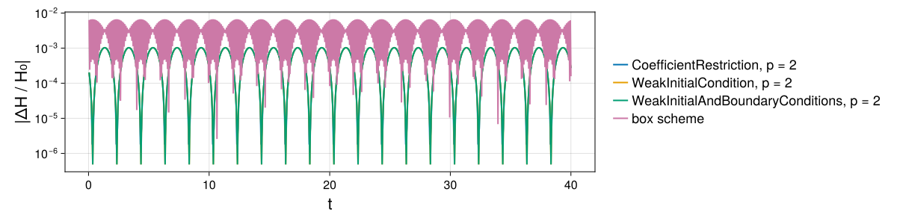

```@meta
CurrentModule = MultisymplecticIntegrators
```

# Verification

The observed orders of the B-spline family under its three couplings and of the box scheme, on a
manufactured solution `u*` of the forced wave equation, and the energy error of a long run. The
tables and the figure are written by `scripts/manual_verification.jl` into `docs/src/assets/`,
where they are committed, so the build of this manual reads them and runs no sweep. The ladders,
the runs and the long-time settings are those of `test/helpers/manufactured.jl`, on which
`test/verification/manufactured.jl` and `test/verification/long_time_energy.jl` assert. Each
caption names the commit and the Julia version of the run.

## The convergence tables

`p` is the spline degree and `D` the number of components of the field. The order of two
consecutive runs is the base-2 logarithm of the ratio of their values.

```@eval
using Markdown, MultisymplecticIntegrators
Markdown.parse(read(pkgdir(MultisymplecticIntegrators, "docs", "src", "assets",
    "convergence_tables.md"), String))
```

## The long-time energy



```@eval
using Markdown, MultisymplecticIntegrators
Markdown.parse(read(pkgdir(MultisymplecticIntegrators, "docs", "src", "assets",
    "long_time_energy.md"), String))
```

## The stability bound

The B-spline slab integrator on the wave equation is stable only up to about `c·h/Δx ≤ 1`, with
`c` the wave speed, `h` the time step and `Δx` the width of a space cell; K62 of `KNOWN_ISSUES.md`
records the measurements. The long-time run above is at `c·h/Δx = 0.5`, and the first rung of the
B-spline self-difference ladder, `h = 0.1` at `nx = 20`, is at `c·h/Δx = 1`, at the bound.

## The families with no table

Five families have no convergence table: the multiplier network, [`NetworkAnsatz`](@ref); the ELM
family, a `:last_layer` network with [`TrainedHiddenLayer`](@ref); the TrialNN family, a network
under [`HardConstraintLifting`](@ref); the symbolic family, [`SymbolicAnsatz`](@ref); and the
fixed-boundary network, [`FixedBoundaryNetwork`](@ref). Their accuracy is set by the network or by
the expression, not by the time step `h` and the space step `Δx`, so a table of orders in `h` and
`Δx` would not measure it. Their tests check the implementation instead: the residual against the gradient
of an independent discrete action, the Jacobian against central differences, and an affine control.

## The scans and the benchmark matrix

The scripts' benchmark matrix (`scripts/run_benchmark.jl`) runs every family on the example
problems at several resolutions, one process per row, and archives per run the solver's stats, the
errors, the energy drift and the wall time; a run that fails or does not converge is a result. The
energy scan and the phase-drift scan of the B-spline family are `scripts/spline_energy_scan.jl`
and `scripts/spline_phase_drift_scan.jl`, and the network family's regularisation scan is a set of
rows of the matrix. `scripts/README.md` says how to run them.
